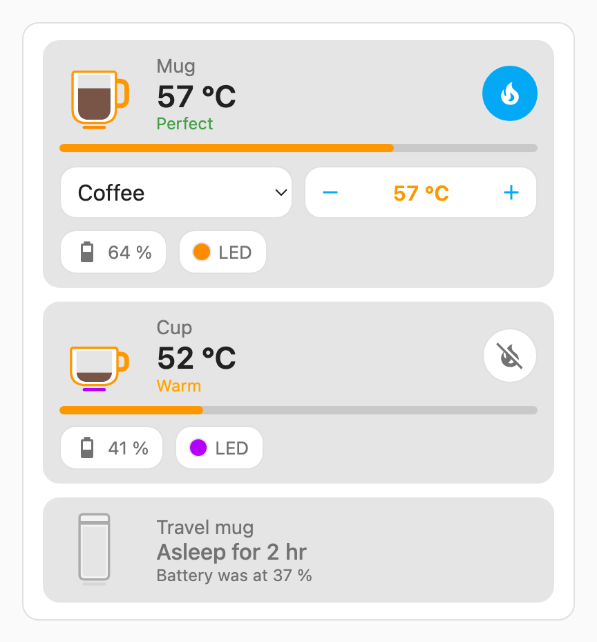

# Ember Card

A Lovelace card for Ember mugs, cups, tumblers and travel mugs set up with the [Ember Mug integration](https://github.com/sopelj/hass-ember-mug-component). One card shows all of them, however many you have: temperature, keep warm, target temperature, presets, fill level, battery and LED color. Colors, fonts and texts follow your Home Assistant theme, your profile's primary and accent color and your language (English and German included). Unofficial; not affiliated with or endorsed by Ember Technologies, product names are trademarks of their respective owners.



## What it shows

- **Header:** a picture of the device (mug, cup, tumbler or travel mug) filled to its current level, the name, the current temperature and the state (heating up, perfect, cooling down, warm …), the fill level as a bar and a round button to switch keeping warm on or off.
- **Target temperature:** minus and plus within the limits of the device. Several taps are sent as one change, so the mug does not get a Bluetooth write for every step.
- **Presets:** a drop-down with the presets you set up in the integration. If the target matches none of them, it says "Custom".
- **Battery:** level and whether it is charging; tap it for the history.
- **LED:** the current color; tap it to pick a new one.
- **Asleep:** an Ember only reports while it is awake. A device that is asleep gets a short row with how long it has been asleep and its last battery level, or it is left out with `hide_sleeping`.

Target and presets are only shown while keep warm is on. On a wide card the devices sit next to each other.

## Requirements

- Home Assistant with the [Ember Mug integration](https://github.com/sopelj/hass-ember-mug-component).
- The card finds the devices and their entities itself. Entities the integration does not provide are left out.

## Installation

**Home Assistant 2026.11 and later (Marketplace):**

1. Add the repository (*Add from link*, `https://github.com/KindOfNerdy/ember-card`):

   [](https://my.home-assistant.io/redirect/marketplace_repositories/)

2. Install the card:

   [](https://my.home-assistant.io/redirect/marketplace_repository/?owner=KindOfNerdy&repository=ember-card&category=plugin)

**Earlier versions:** add the repository in HACS as a custom repository of type *Dashboard*, then download the card.

[](https://my.home-assistant.io/redirect/hacs_repository/?owner=KindOfNerdy&repository=ember-card&category=plugin)

## Usage

Add "Ember" from the card picker and set it up in the visual editor, or use YAML:

```yaml
type: custom:ember-card
```

## Options

| Option | Default | Description |
|---|---|---|
| `title` | – | Title above the devices |
| `devices` | all | Devices to show, in this order (device IDs; the visual editor lets you pick them) |
| `hide_sleeping` | `false` | Leave out devices that are asleep instead of showing a short row |
| `hide` | – | Parts to hide: `picture`, `level`, `keep_warm`, `target`, `presets`, `battery`, `led` |

For example, one card per device without the LED button:

```yaml
type: custom:ember-card
devices: [<device id>]
hide: [led]
```

## Thanks

Ideas and the list of features come from [Flight-Lab/ember-mug-card](https://github.com/Flight-Lab/ember-mug-card); the data comes from [sopelj/hass-ember-mug-component](https://github.com/sopelj/hass-ember-mug-component).

## Support

If this saves you time, you can [buy me a coffee on Ko-fi](https://ko-fi.com/kindofnerdy) ☕
